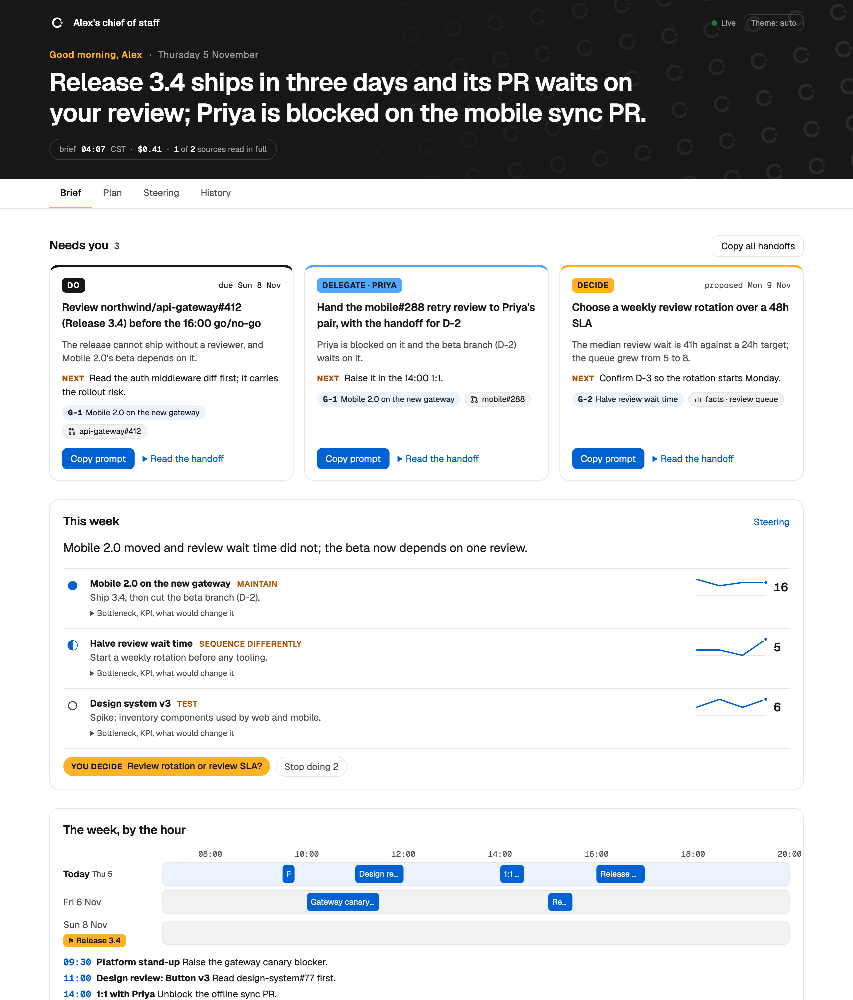
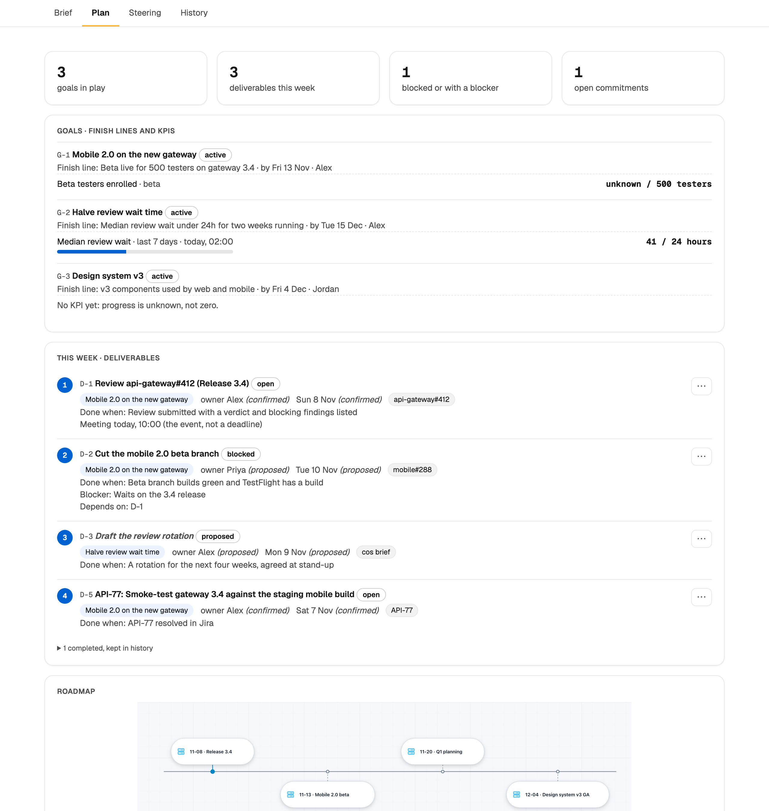
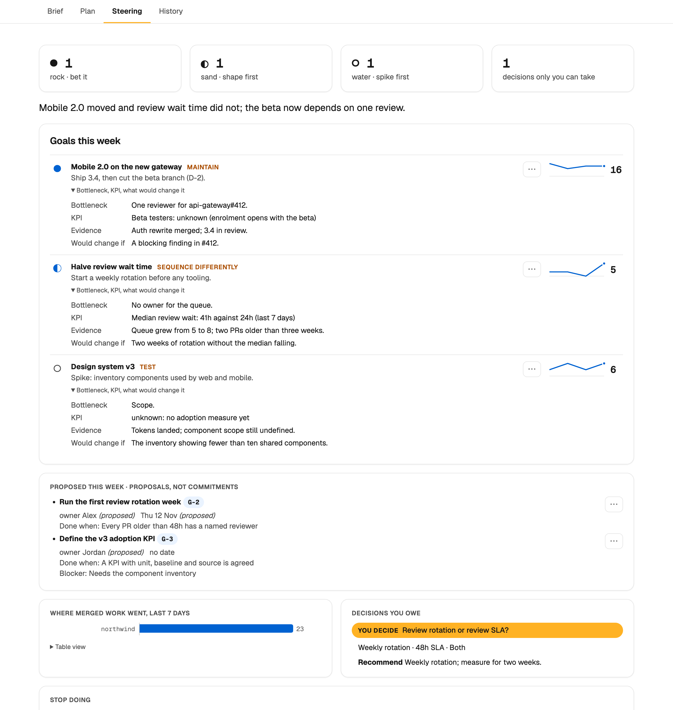
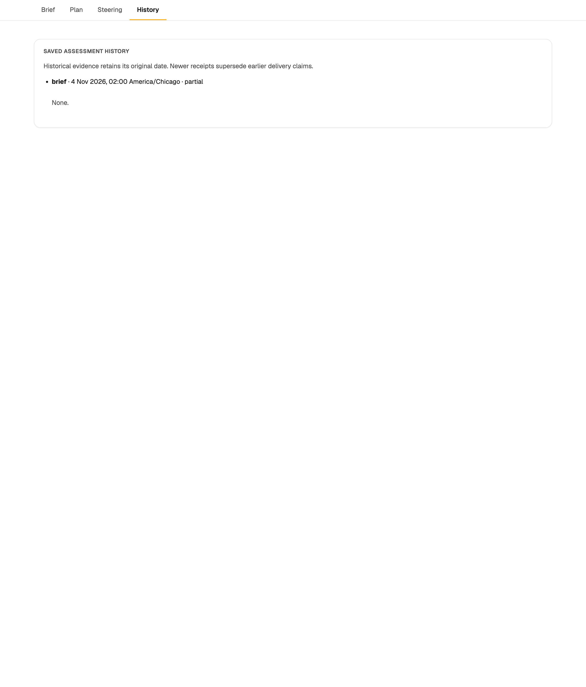
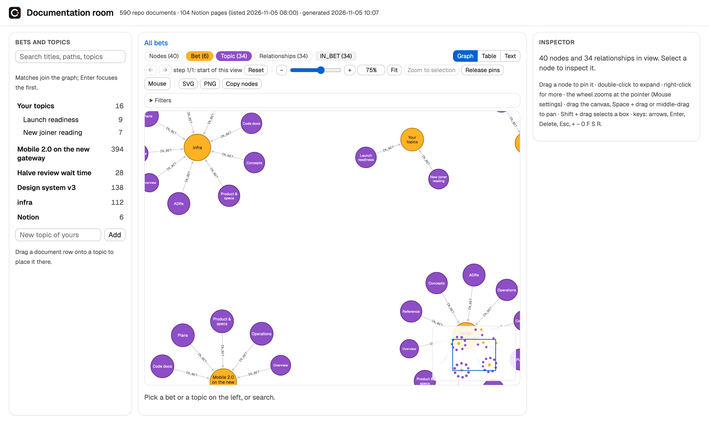
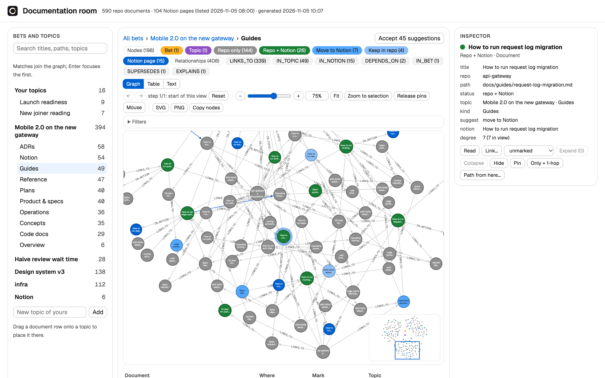
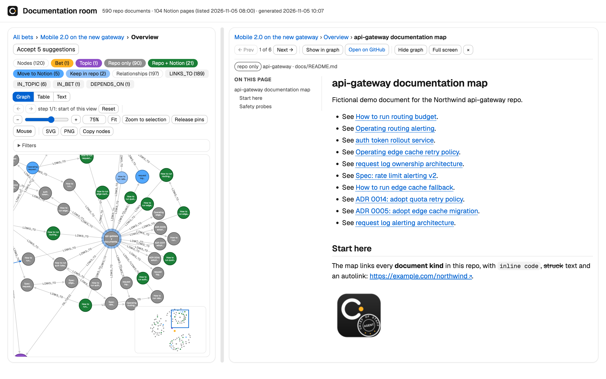
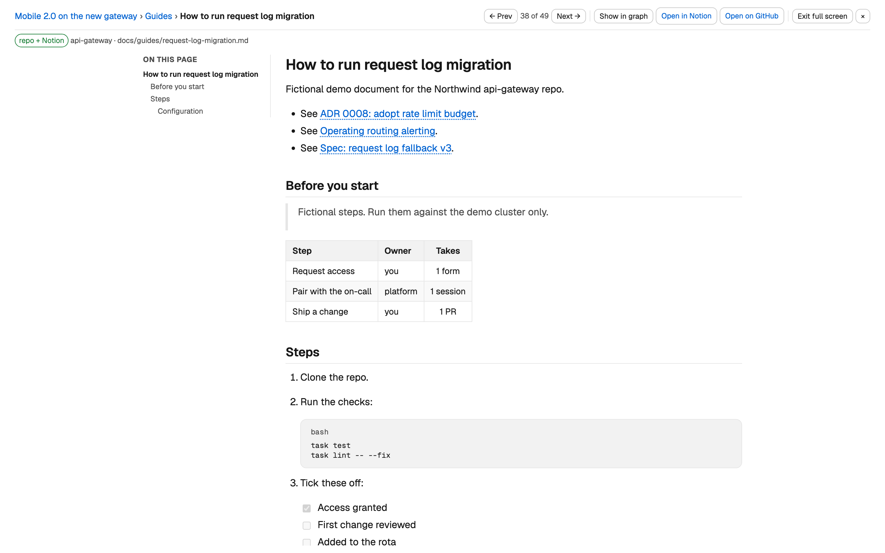

<div align="center">

# cos

**A chief of staff, one brief a day.**<br>
Every morning it reads your calendar, mail, tickets and PRs, tells you who is
waiting on you, and hands you a ready-to-paste agent prompt for each thing to do.
Hand one to an agent and `cos` judges the result on its diff and its checks,
never on what the agent says it did.

[](.github/workflows/ci.yml)
[](#license)
[](Cargo.toml)

[](#install)
[](#where-it-runs)
[](#install)
[](#what-it-does)

[Install](#install) · [What it does](#what-it-does) · [Agents](#agents-judged-on-evidence) · [Where it runs](#where-it-runs) · [Try the demo](#try-the-demo) · [Limits](#limits)

</div>

<picture>
  <source media="(prefers-color-scheme: dark)" srcset="docs/assets/today-dark.png">
  
</picture>

<sub>Every screenshot here is the synthetic demo (`task demo`): a fictional person, company, repos and teammates.</sub>

---

A working day spreads across a calendar, an inbox, a tracker and a review
queue, and the cost is the thing nobody surfaces: who is blocked on you. `cos`
reads the sources you approved and works down from your goals: whether this
week is moving each one and what the week should hold, then at most three
actions that need you today, each tied to a goal or an obligation. A brief
without the week part cost about **$0.35**; with it, not yet measured. It
finishes inside its **300 s** deadline, is **read-only**, and every item
cites its source.

The operating model comes from the **Chief of Staff starter kit** in this repo
([START-HERE.md](START-HERE.md)): goals → KPIs → weekly deliverables →
priorities → delegation, kept in a private journaled workspace
(`.chief-of-staff/`). The kit's skill installs in Codex and in Claude Code;
`cos` runs it on a schedule.

| | Horizon | You get |
|---|---|---|
| **Today** · tactician | today | at most 3 actions (decide / do / delegate / batch) with a handoff each, what changed, meeting prep, a backlog, what each source actually covered |
| **Plan** · the workspace | this week | goals with finish lines and KPIs, deliverables with owners and dates (and whether those are confirmed), "Delegate this" on each |
| **Steering** · the brief's week | this week against your goals | each goal as rock / sand / water with a steer, proposed deliverables, decisions only you can take |
| **History** | every run | a year of shipped work, trends, and an archive of daily reports |

<table>
<tr>
<td width="33%"></td>
<td width="33%"></td>
<td width="33%"></td>
</tr>
</table>

The documentation room (`cos dash` → `/docs`, the desktop app's Docs tab):
every repo document and Notion page grouped by bet, a graph to explore it,
and a reader beside the graph or full screen. Links to files in the repo but
outside the room open on GitHub.

<table>
<tr>
<td width="50%"></td>
<td width="50%"></td>
</tr>
<tr>
<td width="50%"></td>
<td width="50%"></td>
</tr>
</table>

## Install

Needs Claude Code logged in (`claude`), `gh`, Rust and [Task](https://taskfile.dev).
`rust-toolchain.toml` pins Rust 1.99.1, the version CI runs; `rustup toolchain install`
in the repo fetches it. Connect Calendar, Gmail, Atlassian or Notion in claude.ai (`/mcp`).

```sh
git clone https://github.com/decebal/chief-of-staff-v2 && cd chief-of-staff-v2
task setup                  # seed context/ and .chief-of-staff/, build, install cos + agents
# set up goals and approved sources: paste the prompt from START-HERE.md into Claude Code or Codex
cos brief                   # first brief, opens the report
task schedule               # weekdays 08:30 brief, for the active business
```

Several businesses share one install: `cos business add <name> <home> <workspace> <projects>`
registers one, `cos business use <name>` switches, `task schedule BUSINESS=<name>` binds the
scheduled jobs to one. [Usage › Customise](docs/usage.md#customise) has the steps.

## What it does

| | |
|---|---|
| **Reads** | only the sources your profile approves: Calendar, Gmail, Jira/Confluence and Notion through your claude.ai connectors; open, review-requested and merged PRs (`gh`); ready tasks (`cn`) |
| **Writes** | `out/`: briefs, facts, the history ledger, dated HTML reports. `.chief-of-staff/state.json`: a run receipt and source coverage, only if you approved local tracking, through the same validated, journaled commit as the kit's helper. Nothing is sent, merged, commented or edited — tools outside an explicit allowlist are denied, and the brains get no file tools (the workspace and `context/` are inlined). The one task-store write is `cos ritual approve`, which you type at a terminal, or an agent runs with `--yes` when you tell it to approve |
| **Flows** | every ritual flow (a Chronis epic) in the repos under `--projects`, with its step and its beads as a dependency graph: `cos flows`, `/flows` in `cos dash`, the desktop Flows tab; see [Ritual flows](docs/ritual.md) |
| **Sleep** | a brief that fires in a dark wake (a maintenance wake with no display, `pmset -g systemstate` without `Graphics`) is deferred before any model call, exit 75; otherwise `caffeinate -i` holds idle sleep off for the run (closing the lid still sleeps the Mac). The 300 s deadline counts wall-clock time, so a run cut by sleep ends on wake rather than hours later. A timeout, dropped connection or sleep mid-response gets one retry inside the same 300 s. A failed or deferred run is recorded in `out/runs/`, and the Today page says "Today's brief didn't run" above the last brief |
| **Handoffs** | each action and each goal ships a self-contained prompt for Claude Code or Codex that stops before anything outward-facing; `cos handoff D-1` builds the kit's nine-part handoff for a tracked deliverable |
| **Agents** | runs a handoff as Claude Code or Codex in its own worktree, then judges what it left; see [Agents, judged on evidence](#agents-judged-on-evidence) |
| **Charts** | numbers from the facts `cos` collects, never from the model; hand-built SVG with a validated palette, light and dark |
| **Diagrams** | roadmap, goals flywheel and architecture via [Markdy](https://markdy.com) 1.5.7, vendored inline, generated from data |
| **Archives** | one row per day plus every merged PR, seeded with the last year; `cos dash` serves it live |
| **Bounds** | every child process has one deadline and is killed and reaped with its group; every run has a spending cap |

## Agents, judged on evidence

An agent's "done" is a claim. `cos` hires each agent against a contract, and when it ends,
judges it from what it left in the worktree, never from its own summary.

```sh
cos agents spawn --deliverable D-1 --check "task test" --scope src/   # hire against a contract
cos agents watch                                                       # live table until all finish
cos agents show <id>                                                   # verdict, checks, diff, cost, how to resume it
cos agents scorecard                                                   # every verdict, by harness, model and repo
```

| Verdict | When |
|---|---|
| `accepted` | every `--check` passed, re-run by `cos` itself, and the diff stays inside `--scope` |
| `needs_you` | nothing failed, but nothing proves it either: no checks, no changes, or changes outside scope |
| `rejected` | the agent did not finish, or a check failed |
| `rejected!` | *overclaimed*: the agent reported success and a check failed |

- **The contract**: `--check` commands, `--scope` paths and `done_when` (from `--deliverable`).
  Whatever a spawn leaves out comes from the hiring policy in `context/agents.json`, per repo:
  checks, scope, deadline, budget, stall and repeat limits.
- **While it runs**: `stalled` (no output for 10 minutes) and `looping` (the same call, arguments
  and all, five times in a row) show in the verdict column. They flag; they never stop it.
- **Where it runs**: a detached worktree, shell commands with no network, so it cannot push,
  comment or send; a deadline and, for Claude, a spend cap. Past `COS_AGENT_SLOTS` (default:
  cores / 4) agents wait `queued`; each worktree is seeded first (`.cos/seed`, else a clonefile of
  `target/` and `node_modules/`, else a lockfile install), and their `cargo` runs share one
  machine-wide build lock.
- **The scorecard**: every verdict appends to `out/agents/ledger.jsonl`, grouped by
  `cos agents scorecard`, `/agents` and the MCP `agents` tool: runs, accepted, needs you,
  rejected, overclaimed, median cost and time.

Full flags: [Usage › Spin off agents](docs/usage.md#spin-off-agents).

## Where it runs

| | |
|---|---|
| **Terminal** | `cos brief` · `cos ask "release review or bug fix today?"` · `cos state …` · `cos handoff D-1` · `cos report` · `cos agents spawn` / `watch` / `show` / `judge` / `scorecard` · `cos staff-sync` |
| **Browser, live** | `cos dash` → `127.0.0.1:8790`, reloads after every run or state change; `/agents` for running agents; localhost only |
| **Desktop** | `task desktop`: the report plus an agent launcher (any number, any repo, Claude Code or Codex) with live status, logs, stop and clean, in one Tauri window ([apps/desktop](apps/desktop/README.md)) |
| **Claude Desktop · Codex** | `task install-mcp` registers `cos mcp`: `latest_brief` / `plan` / `handoff` / `agents` (free), `brief` / `ask` / `spin_off` (paid), `stop_agent` |
| **claude.ai** | `cos tunnel`: a Cloudflare quick tunnel to a read-only server that can't start paid runs or read the workspace |
| **Claude Code · Codex skill** | the starter skill, from `.claude-plugin/` or `.agents/plugins/` in this repo; the `tactician` agent is installed into `~/.claude/agents/` |

## Try the demo

```sh
task demo                          # synthetic home at /tmp/cos-demo; no account touched
cos --home /tmp/cos-demo dash
```

## Limits

| | |
|---|---|
| **Platform** | Scheduling (launchd) and opening the report are macOS; everything else is plain Rust |
| **Connectors** | One you have not connected is a gap, listed as *not read* — never an empty inbox |
| **History** | Fills two months per run to stay under GitHub's search rate limit; unarchived months show outlined |
| **Tunnel** | Quick-tunnel URLs change on restart; a stable one needs your own Cloudflare domain |
| **Markdy** | Pinned at 1.5.7: its grammar moves fast, so upgrades are deliberate ([vendor/markdy](vendor/markdy/README.md)) |
| **Agents** | Spend is not watched live: Claude reports its cost only when it ends, so `--budget` is the cap. Codex has no spend flag. All checks for one verdict share a 300 s budget |

## Docs

| | |
|---|---|
| [Usage](docs/usage.md) | customising, agents and the hiring policy, Codex timeouts, the remote connector |
| [Ritual flows](docs/ritual.md) | the seven steps, the `ritual-*` markers, approval and what it does not stop, how `cos flows` infers a step |
| [Managed staff](docs/managed-staff.md) | configured mandates, AllStack evidence refresh, handoffs and parking |
| [Design](docs/design.md) | how it works, and the measurements behind each decision |
| [Desktop plan](docs/plans/2026-10-21-desktop-app.md) | the workspace split, the agent governor and seeding, and the Tauri app |
| [Agents tab plan](docs/plans/2026-10-28-agents-tab-design.md) | roles the chief of staff runs, design pack research (shadcn/ui, Basecoat, Geist), the tab redesign |
| [Multiple businesses brief](docs/plans/2026-11-12-multi-business-brief.md) | the problem: one install, several businesses, each with its own home, workspace and projects |
| [Multiple businesses design](docs/plans/2026-11-12-multi-business-design.md) | the business registry, the one resolver, app switching, and launchd per business |
| [Multiple businesses plan](docs/plans/2026-11-12-multi-business-plan.md) | the stories, their gates and the ISA row to test table |
| [Multiple businesses design review](docs/plans/2026-11-12-multi-business-design-review.md) | the final review of the design, verdict clean |
| [Business sidebar and dashboards brief](docs/plans/2026-11-13-business-dashboards-brief.md) | four businesses in a pinned sidebar, each with its own dashboards embedded in the app |

## License

Licensed under either of

- Apache License, Version 2.0 ([LICENSE-APACHE](LICENSE-APACHE) or <https://www.apache.org/licenses/LICENSE-2.0>)
- MIT license ([LICENSE-MIT](LICENSE-MIT) or <https://opensource.org/licenses/MIT>)

at your option.

Unless you explicitly state otherwise, any contribution intentionally submitted
for inclusion in the work by you, as defined in the Apache-2.0 license, shall be
dual licensed as above, without any additional terms or conditions.
