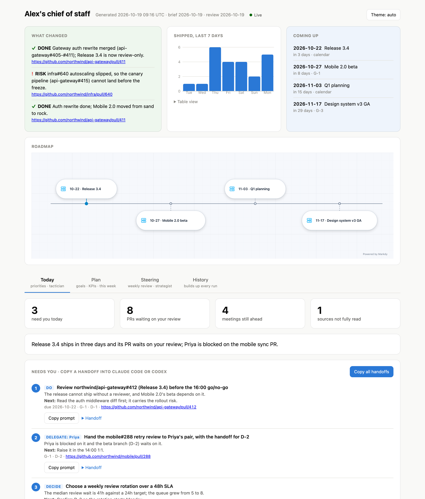
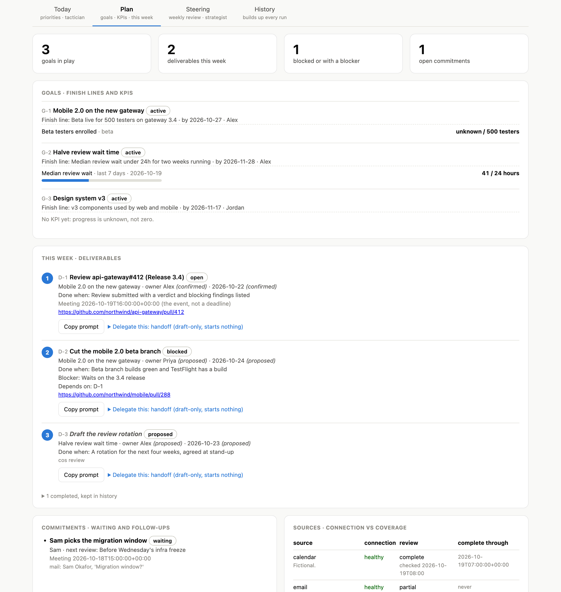
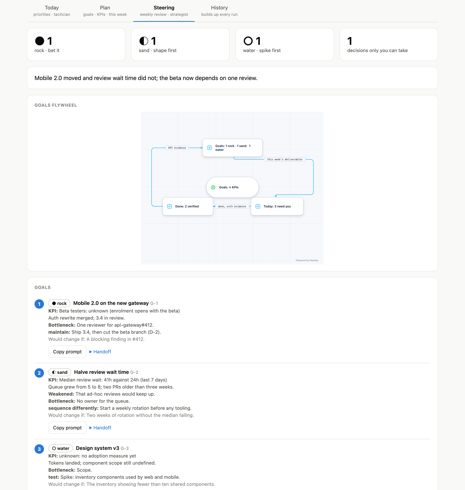
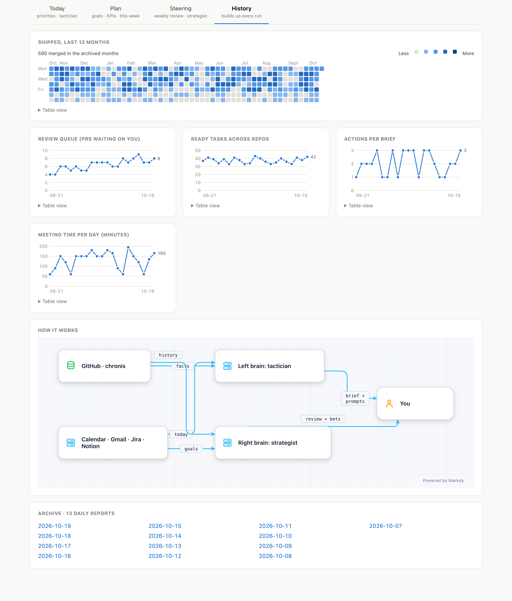

<div align="center">

# cos

**A chief of staff with two brains.**<br>
Every morning it reads your calendar, mail, tickets and PRs, tells you who is
waiting on you, and hands you a ready-to-paste agent prompt for each thing to do.

[](.github/workflows/ci.yml)
[](#license)
[](Cargo.toml)

[](#install)
[](#where-it-runs)
[](#install)
[](#what-it-does)

[Install](#install) · [What it does](#what-it-does) · [Where it runs](#where-it-runs) · [Try the demo](#try-the-demo) · [Limits](#limits)

</div>

<picture>
  <source media="(prefers-color-scheme: dark)" srcset="docs/assets/today-dark.png">
  
</picture>

<sub>Every screenshot here is the synthetic demo (`task demo`): a fictional person, company, repos and teammates.</sub>

---

A working day spreads across a calendar, an inbox, a tracker and a review
queue, and the cost is the thing nobody surfaces: who is blocked on you. `cos`
reads the sources you approved, and returns at most three actions that need
you, each tied to a goal or an obligation. It also checks the week against
your goals and their KPIs. A brief costs about **$0.35** and finishes inside
its **300 s** deadline; it is **read-only** and every item cites its source.

The operating model comes from the **Chief of Staff starter kit** in this repo
([START-HERE.md](START-HERE.md)): goals → KPIs → weekly deliverables →
priorities → delegation, kept in a private journaled workspace
(`.chief-of-staff/`). The kit's skill installs in Codex and in Claude Code;
`cos` runs it on a schedule.

| | Horizon | You get |
|---|---|---|
| **Today** · tactician | today | at most 3 actions (decide / do / delegate / batch) with a handoff each, what changed, meeting prep, a backlog, what each source actually covered |
| **Plan** · the workspace | this week | goals with finish lines and KPIs, deliverables with owners and dates (and whether those are confirmed), "Delegate this" on each |
| **Steering** · strategist | your goals | each goal as rock / sand / water with a steer, proposed deliverables, decisions only you can take |
| **History** | every run | a year of shipped work, trends, and an archive of daily reports |

<table>
<tr>
<td width="33%"></td>
<td width="33%"></td>
<td width="33%"></td>
</tr>
</table>

## Install

Needs Claude Code logged in (`claude`), `gh`, Rust and [Task](https://taskfile.dev).
Connect Calendar, Gmail, Atlassian or Notion in claude.ai (`/mcp`).

```sh
git clone https://github.com/decebal/chief-of-staff-v2 && cd chief-of-staff-v2
task setup                  # seed context/ and .chief-of-staff/, build, install cos + agents
# set up goals and approved sources: paste the prompt from START-HERE.md into Claude Code or Codex
cos brief                   # first brief, opens the report
task schedule               # weekdays 08:30 brief, Fridays 16:00 review
```

## What it does

| | |
|---|---|
| **Reads** | only the sources your profile approves: Calendar, Gmail, Jira/Confluence and Notion through your claude.ai connectors; open, review-requested and merged PRs (`gh`); ready tasks (`cn`) |
| **Writes** | `out/`: briefs, reviews, facts, the history ledger, dated HTML reports. `.chief-of-staff/state.json`: a run receipt and source coverage, only if you approved local tracking, through the same validated, journaled commit as the kit's helper. Nothing is sent, merged, commented or edited — tools outside an explicit allowlist are denied, and the brains get no file tools (the workspace and `context/` are inlined) |
| **Handoffs** | each action and each goal ships a self-contained prompt for Claude Code or Codex that stops before anything outward-facing; `cos handoff D-1` builds the kit's nine-part handoff for a tracked deliverable |
| **Agents** | `cos agents spawn --from brief --item 2` or `--deliverable D-1` runs it: Claude Code or Codex in its own worktree, sandboxed with no network, under a supervisor with a deadline and a spend cap; `cos agents watch` / `tail -f` / `kill` |
| **Charts** | numbers from the facts `cos` collects, never from the model; hand-built SVG with a validated palette, light and dark |
| **Diagrams** | roadmap, goals flywheel and architecture via [Markdy](https://markdy.com) 1.5.7, vendored inline, generated from data |
| **Archives** | one row per day plus every merged PR, seeded with the last year; `cos dash` serves it live |
| **Bounds** | every child process has one deadline and is killed and reaped with its group; every run has a spending cap |

## Where it runs

| | |
|---|---|
| **Terminal** | `cos brief` · `cos review` · `cos ask "release review or bug fix today?"` · `cos state …` · `cos handoff D-1` · `cos report` · `cos agents …` |
| **Browser, live** | `cos dash` → `127.0.0.1:8790`, reloads after every run or state change; `/agents` for running agents; localhost only |
| **Claude Desktop · Codex** | `task install-mcp` registers `cos mcp`: `latest_brief` / `latest_review` / `plan` / `handoff` / `agents` (free), `brief` / `review` / `ask` / `spin_off` (paid), `stop_agent` |
| **claude.ai** | `cos tunnel`: a Cloudflare quick tunnel to a read-only server that can't start paid runs or read the workspace |
| **Claude Code · Codex skill** | the starter skill, from `.claude-plugin/` or `.agents/plugins/` in this repo; the three agents are installed into `~/.claude/agents/` |

## Try the demo

```sh
task demo                          # synthetic home at /tmp/cos-demo; no account touched
cos --home /tmp/cos-demo dash
```

## Limits

| | |
|---|---|
| **Platform** | Scheduling (launchd) and opening the report are macOS; everything else is plain Rust |
| **Connectors** | One you have not connected is a gap, listed as *not read* — never an empty inbox |
| **History** | Fills two months per run to stay under GitHub's search rate limit; unarchived months show outlined |
| **Tunnel** | Quick-tunnel URLs change on restart; a stable one needs your own Cloudflare domain |
| **Markdy** | Pinned at 1.5.7: its grammar moves fast, so upgrades are deliberate ([vendor/markdy](vendor/markdy/README.md)) |

## Docs

| | |
|---|---|
| [Usage](docs/usage.md) | customising, Codex timeouts, the remote connector |
| [Design](docs/design.md) | how it works, and the measurements behind each decision |

## License

Licensed under either of

- Apache License, Version 2.0 ([LICENSE-APACHE](LICENSE-APACHE) or <https://www.apache.org/licenses/LICENSE-2.0>)
- MIT license ([LICENSE-MIT](LICENSE-MIT) or <https://opensource.org/licenses/MIT>)

at your option.

Unless you explicitly state otherwise, any contribution intentionally submitted
for inclusion in the work by you, as defined in the Apache-2.0 license, shall be
dual licensed as above, without any additional terms or conditions.
